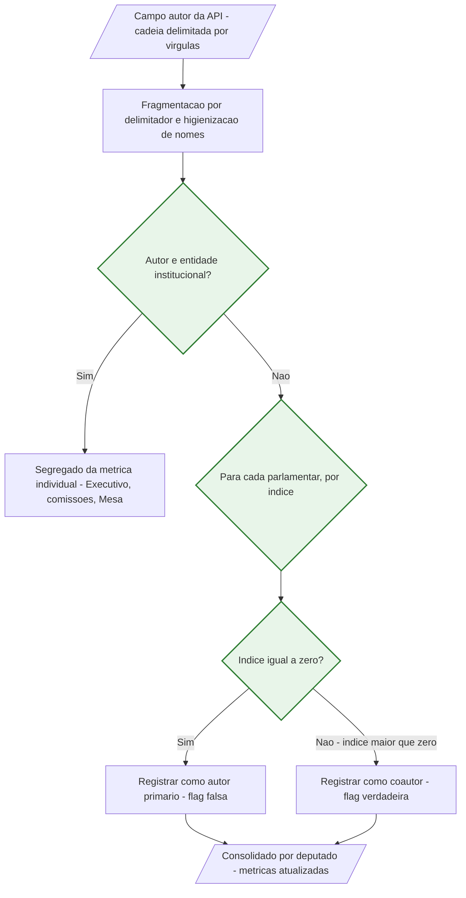
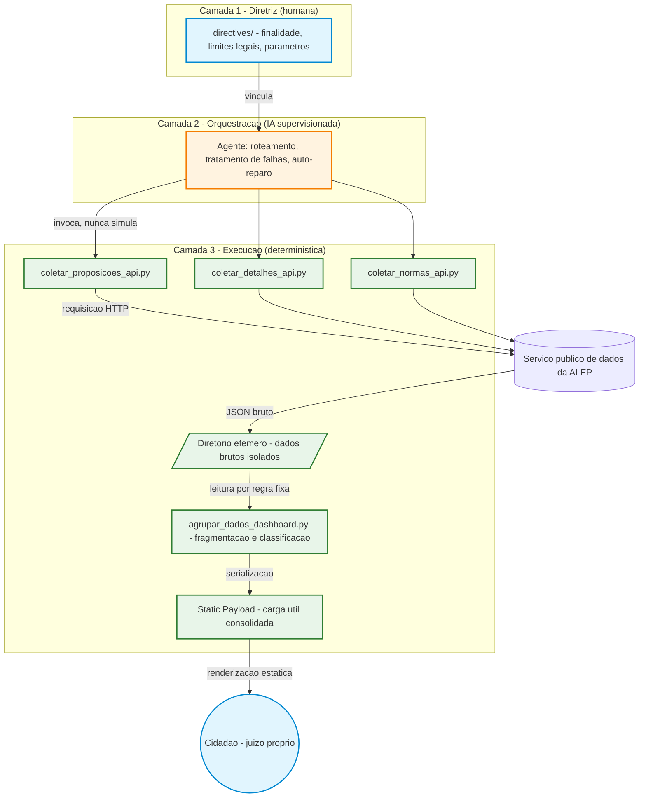

# Projeto ALEP: Inteligência Artificial como Meio de Civilidade

Repositório oficial do Projeto ALEP: uma ferramenta de código aberto para
estruturação, auditoria e exibição transparente dos dados legislativos da
Assembleia Legislativa do Estado do Paraná (ALEP), acompanhada da pesquisa
que a fundamenta.

O trabalho propõe uma **orientação técnica e jurídica** para o emprego de
Inteligência Artificial em sistemas de controle social. Sua tese central é uma
regra de alocação: a IA opera legitimamente na camada de **orquestração** de um
sistema cívico, e é interditada na camada de **adjudicação**, em que fatos são
imputados a agentes públicos identificados. Essa camada exige processamento
determinístico, reprodutível e integralmente explicável.

| | |
|---|---|
| **Recorte** | 20ª Legislatura da ALEP (2023–2026) |
| **Fonte** | Serviço público `webservices.assembleia.pr.leg.br/api/public` |
| **Corpus** | 15.369 proposições · 129.980 eventos de tramitação · 1.677 normas |
| **Licença** | MIT (ver [LICENSE](LICENSE)) |

---

## Instalar e rodar

O projeto não depende de servidor, banco de dados, credenciais ou chave de
acesso. O serviço de dados da ALEP é público e irrestrito. É preciso apenas
Python 3.6 ou superior, e duas bibliotecas.

```bash
git clone https://github.com/MarcusSchneiderAdv/ALEP_ENEIAS.git
```

```bash
cd ALEP_ENEIAS && pip install -r requirements.txt
```

Feito isso, escolha uma das duas formas de obter os dados. Ambas executam o
pipeline inteiro sozinhas, sem passo manual.

**Coletar os dados atuais.** Consulta a Assembleia e devolve o estado de hoje.
O universo será maior que o da pesquisa, porque a legislatura segue em curso.

```bash
python executar.py
```

**Usar os dados publicados.** Restaura o universo de 15.369 proposições sobre o
qual a monografia foi escrita, com integridade conferida por resumo
criptográfico. É o caminho de quem quer auditar os números publicados.

```bash
python executar.py --snapshot
```

Em ambos os casos o programa consulta a Assembleia para obter o estado
processual de cada proposição, o que exige uma requisição por proposição. Numa
coleta do zero isso leva cerca de **50 minutos**, com intervalos entre as
requisições para não sobrecarregar os servidores do Estado. A rotina preserva o
que já baixou, de modo que pode ser interrompida e retomada sem perda.

### O que você recebe

**Um painel visual.** Abra `index.html` no navegador. Traz a produção por
parlamentar, distribuição por espécie, conversão em norma e a linha do tempo de
tramitação de cada proposição.

**Dossiês para consultar com Inteligência Artificial.** Em `dados/perfis/`,
um arquivo por parlamentar, mais um panorama da Casa e uma planilha consolidada.
Anexe o arquivo do parlamentar a um assistente de IA e pergunte em linguagem
natural: quais normas de autoria dele foram sancionadas e sobre o que tratam,
qual a proporção entre projetos de lei e requerimentos, que assuntos concentram
seus requerimentos. As instruções de uso e as ressalvas de leitura estão em
[`dados/perfis/LEIAME.md`](dados/perfis/LEIAME.md).

> Os dossiês descrevem, não qualificam. Não contêm nota, ranking nem juízo de
> desempenho, e isso é deliberado: a qualificação pertence ao cidadão, não ao
> sistema que organiza os dados. O capítulo 4 explica por quê.

As matrizes versionadas em `dados/snapshot_2026-03-22/` existem para auditoria do
que foi publicado, não para uso corrente. Quem quiser trabalhar com dados atuais
deve rodar a coleta.

---

## RESUMO

A transparência formal não produz transparência material. Na 20ª Legislatura da Assembleia Legislativa do Estado do Paraná (ALEP), 15.369 proposições foram publicadas em formato aberto e legível por máquina sem que disso resultasse qualquer capacidade cidadã de avaliação.

Deste diagnóstico deriva uma regra de alocação de competência algorítmica. Em sistemas que produzem afirmações sobre agentes públicos identificados, a Inteligência Artificial opera legitimamente na camada de **orquestração**, decidindo o que executar, tratando falhas e mantendo a rastreabilidade. Na camada de **adjudicação**, em que fatos são classificados e imputados a pessoas determinadas, é interditada: ali o processamento precisa ser determinístico, reprodutível e explicável.

A IA serve à civilidade quando se recusa a julgar. Devolve ao cidadão a capacidade de avaliar, sem substituir esse juízo por um veredito automatizado. A regra é validada por um artefato funcional cujo código-fonte e resultados são reproduzíveis.

**Palavras-chave:** Inteligência Artificial. Civilidade. Transparência pública. Jurimetria. LGPD. Explicabilidade algorítmica. Civic Tech.

---

## 1. INTRODUÇÃO

O Princípio da Publicidade (art. 37, *caput*, da Constituição Federal) é pilar do Estado Democrático de Direito. Com a Lei de Acesso à Informação (Lei nº 12.527/2011), o ordenamento brasileiro transitou de uma cultura de sigilo para a presunção de transparência ativa: os entes estatais, incluído o Legislativo, passaram a ter o dever de disponibilizar dados de suas atividades finalísticas em portais abertos.

Cumprido o dever de publicar, emergiu um paradoxo que a norma não previu. O legislador de 2011 presumiu que a publicação do dado bastaria para viabilizar o controle social, e essa presunção não se confirmou. A ALEP publica integralmente, em formato aberto e estruturado, e ainda assim o cidadão permanece incapaz de responder à pergunta que motiva o voto: *o que meu representante fez?* Publicar deixou de ser sinônimo de tornar acessível.

Este trabalho expõe esse paradoxo pela análise empírica da 20ª Legislatura da ALEP. As 15.369 proposições protocoladas entre 2023 e 2026 são extraídas do serviço público da Casa, reorganizadas por regras verificáveis e devolvidas em forma legível, e o resultado dessa reorganização mede a distância exata entre o que está publicado e o que é compreensível.

É nesse vão que a Inteligência Artificial se apresenta como instrumento de governança. E é nesse mesmo vão que ela se torna perigosa. Um sistema capaz de ler 15.369 proposições e delas extrair um juízo sobre o desempenho de um parlamentar identificado é, ao mesmo tempo, instrumento de emancipação cívica e instrumento de dano reputacional automatizado. A capacidade técnica que traduz o inacessível é a mesma que fabrica a acusação infundada.

Essa ambivalência não é dilema abstrato de ética aplicada. É questão de repartição de competências. A pergunta não é *se* usar IA no controle social, nem *quanta* usar, mas **em qual camada do sistema ela pode operar**, e qual camada o Direito lhe interdita.

### 1.1. O problema: obscuridade por volume

O processo parlamentar abriga proposições de naturezas distintas. De um lado, a produção que inova o ordenamento e institui políticas públicas. De outro, a produção simbólica ou honorífica, composta por votos de louvor, cidadanias honorárias e declarações de utilidade pública, igualmente legítima, mas de eficácia concreta e restrita.

Nos índices oficiais, essas naturezas aparecem indexadas de forma homogênea. Uma lista cronológica não distingue o projeto que reestrutura a política estadual de saúde do requerimento que registra congratulações: ambos ocupam uma linha. O cidadão que consulta o portal não encontra dados falsos. Encontra dados verdadeiros dispostos de modo que impede a formação de juízo. É a **obscuridade por volume**, opacidade produzida não pela ocultação, mas pelo excesso indiferenciado.

Esse vácuo não permanece vazio. É preenchido pela curadoria das redes sociais, na qual o próprio parlamentar seleciona os recortes de sua atuação. A assimetria informacional converte-se em assimetria narrativa.

### 1.2. Objetivos

O objetivo geral é formular e validar uma orientação técnica e jurídica para o emprego de IA em auditoria cívica. Especificamente:

**a)** demonstrar, com dados primários, que a transparência formal é insuficiente para produzir controle social sobre o Legislativo estadual;

**b)** identificar, na LGPD (Lei nº 13.709/2018) e no Projeto de Lei nº 2.338/2023, os deveres que incidem sobre um sistema automatizado que produz afirmações sobre agentes públicos identificados;

**c)** derivar desses deveres um critério objetivo de alocação de competência algorítmica;

**d)** implementar esse critério em artefato funcional, auditável e reproduzível; e

**e)** demonstrar que a abstenção de IA na camada de adjudicação não reduz a utilidade cívica do sistema.

O Marco Legal da IA tramita no Congresso e as primeiras aplicações de jurimetria política já operam sobre dados brasileiros. Faltam critérios operacionais que traduzam princípios abstratos, como explicabilidade, auditabilidade e não discriminação, em decisões concretas de arquitetura de software. A orientação aqui proposta é um desses critérios.

### 1.3. Metodologia e recorte

A abordagem é empírico-jurídica, quantitativa e descritiva, ancorada no dever constitucional de publicidade e no direito fundamental à informação (art. 5º, XXXIII, e art. 37, *caput*, da CF/88). Articula um movimento dogmático, que reconstrói o regime jurídico aplicável (capítulos 2 a 4), e um empírico, que implementa e testa a orientação daí derivada (capítulos 5 e 6).

**Recorte.** O universo compreende a integralidade das proposições protocoladas na ALEP entre 2023 e 2026, extraídas do serviço público da Casa (`webservices.assembleia.pr.leg.br/api/public`). São **15.369 proposições**, das quais 14.650 têm autoria parlamentar individualizável. As 719 restantes são de iniciativa institucional, oriundas do Poder Executivo, de comissões ou da Mesa, e foram segregadas por não se prestarem à métrica de desempenho individual. Sobre a totalidade do universo foram coletados registros de detalhe, dos quais se extraíram **129.980 eventos de tramitação** e **1.677 vínculos a normas sancionadas**.

**Dois marcos temporais.** A pesquisa distingue duas datas que respondem a perguntas diferentes, e a distinção é metodologicamente relevante.

O **fechamento do universo** ocorreu em 22 de março de 2026. É a data que define quais proposições integram o estudo, e a partir dela nenhuma proposição nova foi acrescentada. O objeto é uma legislatura em curso, e o Parlamento seguiu legislando: uma consulta de aferição em agosto de 2026 devolveu 17.239 proposições, contra as 15.369 do corte, sendo a diferença integralmente do exercício de 2026.

A **observação do estado processual** ocorreu em 24 de agosto de 2026. Fixado o universo, o percurso de cada proposição dentro dele continua evoluindo, e essa segunda data registra até onde esse percurso foi acompanhado. O evento de tramitação mais recente é de 20 de agosto de 2026 e a norma mais recente é de 27 de julho de 2026.

A separação evita uma confusão comum em estudos legislativos. Um universo congelado com estado processual desatualizado subestima a conversão normativa, porque matérias sancionadas após a coleta aparecem como pendentes. Um universo aberto com estado atualizado impede a reprodução, porque a base muda a cada execução. A combinação adotada, universo fixo e estado observado em data declarada, preserva as duas propriedades.

**Cobertura.** Os registros de detalhe foram obtidos para a totalidade das 15.369 proposições do universo. As matrizes JSON foram congeladas e versionadas no repositório com resumo criptográfico por exercício, e o procedimento de restauração consta do Apêndice A.

---

## 2. TRANSPARÊNCIA PÚBLICA COMO PRESSUPOSTO DE CIVILIDADE

O controle social sobre a Administração é um dos pilares do Estado Democrático de Direito, e seu exercício depende de uma condição prévia que a norma brasileira presume satisfeita: a de que o cidadão consiga compreender aquilo que lhe é dado ver. Este capítulo examina essa condição.

O paradigma estatal caracterizava-se historicamente pelo sigilo como regra e pela publicidade como exceção, o que restringia a capacidade de fiscalizar o poder. Com o constitucionalismo contemporâneo, a informação pública passa a ser bem difuso, titularizado pela coletividade e gerido transitoriamente por seus representantes. Ives Gandra da Silva Martins fixa a exigência ao afirmar que "exceção feita às questões de segurança nacional, os atos administrativos devem ser transparentes, não se admitindo decisões escusas, resoluções de gaveta, visto que o administrado não pode desconhecer as regras da Administração" (MARTINS, 2006, p. 18).

O percurso do capítulo é o seguinte. O item 2.1 reconstrói o regime jurídico da publicidade, do mandamento constitucional ao imperativo tecnológico de dados abertos, e demonstra que a ALEP o cumpre. O item 2.2 mostra por que esse cumprimento não basta, introduz a distinção entre transparência formal e material, e fixa o limite que estrutura todo o restante do trabalho: a ferramenta de auditoria traduz, mas não julga.

Convém precisar antes o sentido em que se emprega o termo **civilidade**. Não designa cortesia no debate público nem moderação retórica. Designa a condição material que habilita o cidadão a participar da vida pública em termos informados, isto é, a capacidade efetiva de formar juízo próprio sobre a conduta de quem exerce mandato em seu nome. Nessa acepção, a civilidade é destruída pelo sigilo, pelo excesso indiferenciado e por um sistema automatizado que substitui o juízo do cidadão por um veredito de máquina. As três hipóteses produzem o mesmo resultado: um cidadão que não avalia.

### 2.1. O Princípio da Publicidade e a Lei de Acesso à Informação

O Princípio da Publicidade está consagrado no *caput* do art. 37 da CF/88 como condição de validade e de controle democrático. Transcende a formalidade da publicação oficial, pois é o vetor que legitima a atuação estatal. Nas palavras de Celso Lafer:

> "numa democracia a visibilidade e a publicidade do poder são ingredientes básicos, posto que permitem um importante mecanismo de controle *ex parte populi* da conduta dos governantes. [...] Numa democracia a publicidade é a regra básica do poder e o segredo, a exceção, o que significa que é extremamente limitado o espaço dos segredos de Estado" (LAFER, 1988, p. 243-244 *apud* MEDAUAR, 2018, p. 125).

A Lei de Acesso à Informação superou o modelo de publicidade passiva e instituiu o dever de transparência ativa. Seu art. 8º obriga os entes públicos a divulgar informações de interesse coletivo independentemente de requerimento.

A legislação impõe ainda um imperativo tecnológico: o art. 8º, § 3º, II e III, determina que as informações sejam oferecidas em formatos abertos, estruturados e legíveis por máquina. O Decreto nº 8.777/2016, que institui a Política de Dados Abertos do Poder Executivo federal, consolida a exigência:

> Art. 3º A Política de Dados Abertos do Poder Executivo federal será regida pelos seguintes princípios e diretrizes:
> I - observância da publicidade das bases de dados como preceito geral e do sigilo como exceção;
> II - garantia de acesso irrestrito às bases de dados, as quais devem ser legíveis por máquina e estar disponíveis em formato aberto;
> [...]
> V - completude e interoperabilidade das bases de dados, as quais devem ser disponibilizadas em sua forma primária, com o maior grau de granularidade possível [...].

Dirigido formalmente ao Executivo federal, o Decreto materializa o padrão tecnológico máximo da transparência que a LAI impõe universalmente, e a LAI vincula o Legislativo estadual. No mesmo sentido orienta a Controladoria-Geral da União ao consolidar que a transparência ativa deve privilegiar formatos que permitam reuso e cruzamento automatizado (BRASIL, 2022).

A ALEP cumpre esse dever. Disponibiliza serviço público de dados, com respostas em JSON estruturado e sem exigência de credenciamento. O problema examinado não é de ilegalidade, mas de insuficiência, e por isso a solução não pode ser normativa, e sim tecnológica.

### 2.2. Transparência material e o limite do tradutor

A disponibilização de dados brutos não atinge a plenitude do Princípio da Publicidade. Instala-se a dicotomia entre a **transparência formal**, que é a existência do dado em formato aberto, e a **transparência material**, que é a capacidade real de o cidadão leigo visualizar, compreender e auditar o ato. Ao descarregar volume massivo de informação desestruturada, o Estado cumpre a etapa burocrática e falha na efetivação democrática. A publicidade exige cognoscibilidade.

Odete Medauar adverte que "o secreto, invisível, reinante na Administração, mostra-se contrário ao Estado Democrático" (MEDAUAR, 2018, p. 235), lição que alcança toda forma de inacessibilidade material, não apenas o sigilo deliberado.

O Judiciário já reconheceu institucionalmente o problema. Historicamente marcado pelo hermetismo vocabular, admitiu que a publicação de sentenças nos diários oficiais não efetivava o direito à informação. Em resposta, o Conselho Nacional de Justiça instituiu o "Pacto Nacional do Judiciário pela Linguagem Simples", pela Recomendação nº 144/2023, determinando que decisões sejam acompanhadas de resumos capazes de explicar "o impacto da decisão ou do julgamento na vida de cada pessoa e da sociedade brasileira" (CONSELHO NACIONAL DE JUSTIÇA, 2023, p. 3).

Se no Judiciário a barreira é o vocabulário hermético, no Legislativo é o volume indiferenciado. Entregar ao eleitor uma resposta de interface com milhares de chaves JSON equivale a entregar um acórdão de centenas de páginas a um leigo: ambos são documentos públicos e ambos são materialmente opacos. A ferramenta proposta é o análogo digital do Pacto pela Linguagem Simples, transposto para o Legislativo estadual.

Daí decorre o limite que estrutura todo o restante do trabalho. A ferramenta de auditoria cívica é **tradutora, não juíza**. Sua legitimidade vem de restituir ao cidadão a informação em forma inteligível, e cessa no instante em que ela própria emite o juízo que caberia ao cidadão formar. Um sistema que informa "o deputado X apresentou 480 proposições, das quais 22% são projetos de lei" cumpre a função de civilidade. Um sistema que informa "o deputado X tem desempenho abaixo da média" a usurpa, pois substituiu o eleitor no ato de avaliar.

A distinção não é preciosismo. É a fronteira que o capítulo 4 reconstruirá a partir do ordenamento vigente, e que a arquitetura do capítulo 5 implementa em código.

---

## 3. O OBJETO: A PRODUÇÃO LEGISLATIVA ESTADUAL

Antes de propor qualquer tratamento automatizado, é preciso saber o que exatamente será tratado. Este capítulo delimita o objeto, e a delimitação não é preliminar burocrática: dela dependem tanto a legitimidade da classificação quanto o alcance do que a máquina pode afirmar.

O Legislativo estadual é o epicentro da representação popular, e essa representação desdobra-se em ritos desenhados para finalidades distintas, da inovação da ordem jurídica à fiscalização do Executivo e à articulação regional. A consolidação diária dessa pluralidade em plataformas digitais cumpre o requisito formal da publicidade e produz denso acúmulo de dados indiferenciados.

O capítulo percorre dois movimentos. O item 3.1 examina as espécies proposicionais da ALEP à luz da distinção dogmática entre lei em sentido formal e lei em sentido material, e demonstra que os atos protocolados se distribuem em três grupos de natureza jurídica diversa, um dos quais a distinção clássica sequer contempla. Desse exame resulta a constatação decisiva para a arquitetura: parte dessas fronteiras é registral, isto é, consta do dado oficial, e parte só se alcança por juízo sobre o conteúdo. O item 3.2 trata da consequência prática dessa indiferenciação, que é a impossibilidade de aferir produtividade parlamentar, e do modo como esse vácuo é preenchido pela comunicação política.

### 3.1. Espécies proposicionais e a distinção entre lei formal e material

A autonomia organizativa dos Estados decorre dos arts. 25 e 27 da CF/88, cabendo ao Regimento Interno da ALEP disciplinar as espécies proposicionais e seus ritos.

A estruturação desses ritos apoia-se na distinção entre **lei em sentido material** e **lei em sentido formal**. A distinção exige precisão dogmática, sob pena de erro categorial: não são duas espécies de lei que se excluem, mas **dois critérios independentes**, um relativo ao conteúdo, outro à origem e ao procedimento.

José Afonso da Silva formula ambos. Quanto ao conteúdo:

> "No sentido material, a lei consiste num ato normativo de caráter geral, abstrato e obrigatório, tendo como finalidade o ordenamento da vida coletiva, no sentido de trazer certeza, precisão e garantia às relações jurídicas. [...] **Não importa quem o produza**" (SILVA, 1999, p. 13).

Quanto à forma:

> "Já no sentido formal, lei é o ato jurídico emanado do Poder Legislativo composto de representantes do povo, elaborado e aprovado de acordo com o processo legislativo estabelecido na Constituição, **abstração feita de seu conteúdo**" (SILVA, 1999, p. 13).

O critério material indaga *o que* o ato dispõe; o formal, *de onde* e *como* ele provém. Os dois convergem na maior parte dos casos, e o próprio Silva desfaz a leitura dicotômica corrente: "Quase sempre, no entanto, a lei formal contém as características da lei material, havendo, assim, coincidência entre forma e conteúdo da lei. No entanto, lei em sentido material pode provir do Poder Executivo, como é o caso do decreto-lei" (SILVA, 1999, p. 13).

A distinção só produz consequência prática nas hipóteses de **não coincidência**, e são duas. Há normas materialmente legislativas que não emanam do Parlamento, como decretos, regulamentos e medidas provisórias. E há o inverso, que são atos percorrendo o processo legislativo mas cujo conteúdo não é geral nem abstrato. A doutrina administrativista nomeia essa categoria de **lei de efeito concreto**. Maria Sylvia Zanella Di Pietro a define como lei "apenas, em sentido formal, porque emana do Legislativo e obedece ao processo de elaboração das leis, mas são verdadeiros atos administrativos, quanto ao seu conteúdo" (DI PIETRO, 2009). Ao tratar da declaração de utilidade pública, a autora oferece formulação que se aplica ao objeto aqui examinado: "lei em sentido formal, porque emana do Legislativo; mas ato administrativo em sentido material, porque alcança pessoa determinada" (DI PIETRO, 2009). Odete Medauar registra o mesmo termo técnico ao tratar do cabimento de mandado de segurança contra lei de efeito concreto (MEDAUAR, 2018).

Aplicada ao objeto, a dogmática impõe uma terceira categoria que a distinção clássica não contempla. Os atos protocolados na ALEP distribuem-se em três grupos:

**a) Lei em sentido formal e material.** Projetos de lei que instituem políticas públicas de alcance geral e abstrato. Aqui há a coincidência que, segundo Silva, é a regra.

**b) Lei apenas em sentido formal, ou lei de efeito concreto.** Projetos de lei que declaram utilidade pública ou concedem cidadania honorária. Percorrem o processo legislativo, mas alcançam pessoa determinada, e no conteúdo são atos administrativos. No corpus, 680 proposições de utilidade pública tramitaram como projeto de lei, o que confirma o enquadramento.

**c) Atos que não são lei em sentido algum.** Votos de louvor, congratulações e menções honrosas não constituem lei nem material nem formalmente, porque não percorrem o processo legislativo: são requerimentos, atos de expediente parlamentar. A verificação empírica é inequívoca, pois das proposições que veiculam menção honrosa 3.432 são requerimentos contra 4 projetos de lei, e entre as de congratulações as 3.070 ocorrências são todas requerimentos. Enquadrá-las como "lei em sentido formal" é erro categorial, e é erro que a indexação homogênea dos portais induz.

Nenhum desses grupos é hierarquicamente superior aos demais. Requerimentos cumprem função fiscalizatória e de articulação regional constitucionalmente legítima, e leis de efeito concreto atendem demandas locais que o ordenamento reconhece. A tripartição é descritiva.

Sua relevância para a arquitetura é outra, e é precisa. **A fronteira entre o grupo (c) e os demais é visível no dado oficial**, pois coincide com o campo `tipoProposicao` atribuído pela Casa. Já a fronteira interna entre (a) e (b) **não é registral**: separar o projeto de lei geral e abstrato daquele de efeito concreto exige juízo sobre o conteúdo da ementa. É o tipo de qualificação que a regra do capítulo 4 interdita ao sistema, e que o artefato deixa ao leitor.

### 3.2. A opacidade da produtividade parlamentar

A avaliação de desempenho dos agentes políticos perpassa o Princípio da Eficiência, alçado ao *caput* do art. 37 pela Emenda Constitucional nº 19/1998. Hely Lopes Meirelles leciona que a eficiência "exige que a atividade administrativa seja exercida com presteza, perfeição e rendimento funcional" (MEIRELLES, 2016, p. 119). A aplicação desse crivo ao Legislativo esbarra em obstáculo severo: a produtividade parlamentar é desconhecida pelo público leigo.

Não há, nos portais tradicionais, avaliação consolidada que traduza o esforço do mandato. Diante desse vácuo, a percepção de eficiência é construída alhures, primordialmente nas redes sociais, onde o parlamentar destaca recortes midiatizados de sua atuação e edifica narrativa que pode não refletir a distribuição real de sua produção.

Cabe uma ressalva. **A curadoria não é ilícita nem reprovável**, pois comunicar a própria atuação é parte legítima do mandato representativo. O problema não é o parlamentar selecionar o que divulga, e sim o eleitor não dispor de fonte alternativa contra a qual conferir a seleção. A ferramenta não se opõe à narrativa política, mas garante que exista, ao lado dela, um registro estruturado que o cidadão possa consultar por conta própria.

---

## 4. O REGIME JURÍDICO DA IA APLICADA AO CONTROLE SOCIAL

A ciência de dados aliada ao Direito deixa de ser suporte operacional e assume o papel de instrumento de governança. Assumir esse papel implica assumir um regime jurídico, e é esse regime que este capítulo reconstrói.

A reconstrução importa porque a discussão pública sobre IA no setor público costuma oscilar entre dois extremos igualmente inúteis. De um lado, a proibição genérica, que ignora ganhos reais e não oferece critério. De outro, a permissão fundada em acurácia, que trata um problema jurídico como se fosse estatístico. Nenhuma das posições responde à pergunta que um projetista precisa responder diante de cada componente do sistema: *este aqui pode ser probabilístico?*

O capítulo avança em quatro movimentos. O item 4.1 caracteriza a matéria-prima, o Big Data jurídico, e delimita o emprego da jurimetria a contar e organizar, não a prever. O item 4.2 expõe o risco do processamento, que é o viés algorítmico, e o dever de explicabilidade que o ordenamento lhe opõe, demonstrando que explicabilidade plena exige regra enunciável e não apenas código publicado. O item 4.3 identifica os dispositivos incidentes na LGPD e no Marco Legal da IA em formação, com destaque para o direito de contestação. Desses três movimentos o item 4.4 deriva a regra de alocação de competência algorítmica, que é a contribuição normativa do trabalho e o critério que organiza toda a arquitetura do capítulo seguinte.

### 4.1. Big Data jurídico e jurimetria

Ao contrário de bases exatas, como registros contábeis, a produção legislativa é textual, massiva e complexa. A literatura aponta que "os dados jurídicos frequentemente exibem características não estruturadas, como conceitos legais, textos legislativos, julgamentos, comentários jurídicos, etc." (LAI *et al.*, 2023). A massa textual do Legislativo exige técnicas de *parsing* rigorosas para equalizar divergências de forma, e a linguagem das ementas exige rigor técnico porque seu teor gera repercussões políticas materiais.

A **jurimetria**, aplicação de métodos estatísticos e computacionais ao Direito, atua na mensuração e organização desse acervo. Seu emprego aqui é delimitado: não se destina a **prever** decisões, mas a **contar e organizar** fatos registrais consumados. A distinção é jurídica, não apenas técnica. A predição projeta sobre o sujeito comportamento futuro que ele ainda não praticou, ao passo que a contagem reorganiza o que ele já praticou e o Estado já publicou. A primeira demanda justificação, e a segunda é exercício de leitura.

### 4.2. Viés algorítmico e o dever de explicabilidade

Subsiste no imaginário social a falácia de que classificações feitas por máquinas são imparciais. A doutrina adverte para o **viés algorítmico**: os algoritmos refletem as premissas, omissões e desvios de finalidade de seus desenvolvedores, e podem gerar resultados discriminatórios sem governança estrita.

No Big Data legislativo, o risco adquire contornos de responsabilidade civil e política. Um sistema que classifique erroneamente um projeto de lei de alto impacto como "ato simbólico" prejudica a reputação e a métrica de desempenho de um agente político. O dano é assimétrico e de difícil reparação, pois a retificação técnica raramente alcança o público que a classificação equivocada atingiu. A literatura que mapeia a intersecção entre modelos de linguagem e Direito registra que a opacidade dos sistemas contemporâneos e as limitações de seus conjuntos de dados obstam sua aplicação em domínios que exigem justificação (LAI *et al.*, 2023).

Contra esse risco o Direito prescreve a **explicabilidade**. Não basta que a máquina entregue o resultado, pois o processo lógico que a ele conduziu precisa ser rastreável e auditável. Luís Roberto Barroso assevera que "deve se investir especialmente em salvaguardas de caráter preventivo, com a adoção de programas de integridade nas gestões pública e empresarial, bem como com a imposição de deveres de imparcialidade, neutralidade e transparência" (BARROSO, 2019, p. 1294).

A exigência tem consequência técnica que costuma passar despercebida. Explicabilidade não se satisfaz com a divulgação do código de um modelo probabilístico: um classificador estatístico pode ter seus pesos publicados e permanecer inexplicável, porque a razão de uma classificação individual não é recuperável a partir deles. Explicabilidade plena exige responder, para **cada** resultado, *por que este caso recebeu esta classificação*, e responder com uma regra, não com uma correlação.

### 4.3. LGPD e o Marco Legal da IA

Embora as informações coletadas da ALEP tenham caráter institucional e público, a LGPD impõe que a publicidade primária do dado não afasta o dever de tratá-lo com adequação, segurança e estrita finalidade (art. 6º). Dois dispositivos incidem diretamente sobre o objeto.

O **art. 20** assegura ao titular o direito de solicitar revisão de decisões tomadas unicamente com base em tratamento automatizado que afetem seus interesses, inclusive as destinadas a definir seu perfil profissional. Um sistema que atribuísse automaticamente qualificação de desempenho a um parlamentar identificado incidiria nessa hipótese.

O **art. 7º, § 3º** estabelece que o tratamento de dados tornados manifestamente públicos não dispensa a observância dos princípios legais e dos direitos do titular. É a base normativa da afirmação central deste capítulo: **o dado ser público não torna livre o que se faz com ele**.

Quanto à regulação do próprio algoritmo, o **Projeto de Lei nº 2.338/2023** institui o Marco Legal da Inteligência Artificial. Aprovado por unanimidade no Plenário do Senado em 10 de dezembro de 2024, tramita na Câmara com expectativa de deliberação final em 2026. Não é proposição incipiente, mas diploma que já obteve consenso em uma das Casas, circunstância que confere às suas diretrizes força de vetor interpretativo antes mesmo da vigência. Na esteira do modelo europeu, estrutura-se pela classificação por níveis de risco e assegura aos afetados direitos de transparência, explicação e contestação:

> "O texto estabelece fundamentos para o desenvolvimento e uso ético desses sistemas, incluindo a centralidade da pessoa humana e o respeito a valores democráticos. Entre as diretrizes, impõe-se a garantia dos princípios da transparência, da explicabilidade, da inteligibilidade e da auditabilidade, assegurando às pessoas afetadas o direito de compreender e contestar os critérios técnicos das decisões automatizadas" (BRASIL, 2023).

O elemento decisivo é o **direito de contestar**. Contestar pressupõe conhecer o critério, e conhecer o critério pressupõe que exista critério enunciável. Um sistema cuja classificação decorre de correlações distribuídas por milhões de parâmetros não oferece objeto contestável, e sim um resultado que se pode lamentar. A garantia de contestabilidade não é obrigação acessória de documentação: é restrição de projeto que determina quais técnicas são admissíveis em cada função do sistema.

### 4.4. A regra de alocação de competência algorítmica

> **Regra de alocação.** Em um sistema automatizado de auditoria cívica, o processamento probabilístico é admissível nas camadas cujos erros são *recuperáveis pelo próprio sistema e invisíveis ao sujeito auditado*, e é interditado nas camadas cujos erros *se convertem em afirmação pública sobre pessoa determinada*.

O critério não pergunta se a técnica é sofisticada, nem se é acurada. Pergunta **quem suporta o erro**. Quando um componente erra e o sistema detecta, corrige e repete a operação, o erro é interno e nenhum direito de terceiro foi tocado. Quando um componente erra e o resultado sai impresso ao lado do nome de um parlamentar, o erro tornou-se imputação.

A regra reparte o sistema em três camadas:

**Diretriz (o quê).** Define escopo, limites legais e critérios de auditoria. Competência estritamente humana, pois nenhuma finalidade de tratamento pode ser fixada pelo próprio sistema, sob pena de esvaziamento do princípio da finalidade (LGPD, art. 6º, I).

**Orquestração (quem e quando).** Decide qual rotina executar, em que ordem, como reagir a falhas de rede, quando uma extração está completa, como diagnosticar mudança na estrutura de uma interface de dados. **Aqui a IA opera com ganho real.** Um erro de orquestração, como invocar a rotina errada ou interpretar mal um código de retorno, é detectável, reversível e não produz afirmação sobre pessoa alguma. É erro de meio.

**Adjudicação (o quê é verdade sobre quem).** Determina que uma proposição pertence a determinado parlamentar, que possui determinada natureza, que se converteu ou não em norma. **Aqui a IA é interditada.** O erro é afirmação falsa sobre pessoa identificada, publicada e indexada, isto é, erro de resultado. O direito de contestação exige que essa camada opere por regras enunciáveis, verificáveis linha a linha e reproduzíveis por terceiros.

Duas consequências. A primeira é que a regra não é antitecnológica, pois não recomenda menos automação, e sim automação alocada: o sistema do capítulo 5 é integralmente automatizado, e a IA nele desempenha função verificável. A segunda é que a regra é falseável, porque se a abstenção de IA na camada de adjudicação empobrecesse o resultado cívico, estaria refutada na prática, ainda que correta em tese. O capítulo 6 apresenta os dados que permitem julgar o ponto.

É assim que a Inteligência Artificial se converte em meio de civilidade: não por decidir melhor que o cidadão, mas por operar a máquina que devolve ao cidadão as condições de decidir.

---

## 5. A ARQUITETURA E.N.E.I.A.S.

A regra do capítulo anterior seria inútil se não fosse implementável. Este capítulo demonstra sua implementação, e a demonstração vale menos pelo que o sistema faz do que pelo que ele se recusa a fazer.

A arquitetura chama-se **E.N.E.I.A.S.**, Ecossistema Nativo de Extração, Investigação e Aprendizado Supervisionado. A última expressão exige precisão terminológica, pois "aprendizado supervisionado" não designa aqui a técnica estatística homônima. Designa o regime de operação da camada de orquestração, em que o agente de IA atua sob supervisão humana permanente e sob diretrizes escritas que não pode alterar unilateralmente. Nenhum modelo é treinado e nenhuma inferência estatística produz resultado exibido ao cidadão, de modo que a supervisão é jurídica e processual, não estatística.

Sob a ótica da engenharia de software, a arquitetura adota o princípio da *Separation of Concerns*, repartindo o ecossistema nas três camadas que a regra prescreve. Os itens seguintes percorrem cada uma delas: o 5.1 trata da diretriz, competência humana indelegável que fixa a finalidade antes de qualquer coleta; o 5.2 trata da orquestração, único domínio em que a IA opera, e relata um episódio de auditoria que demonstra tanto seu valor quanto sua contenção; e o 5.3 trata da execução determinística, que é a camada de adjudicação, detalhando a ingestão, a distribuição de coautoria, a classificação por chave oficial e a entrega ao cidadão.

### 5.1. Camada 1, Diretriz

Documentos versionados em Markdown (`directives/`) definem objetivos, limites legais, parâmetros técnicos e regras de negócio de cada rotina. São procedimentos operacionais padrão legíveis por humanos e por agentes.

Sua função jurídica é fixar a **finalidade** do tratamento antes que qualquer dado seja tocado (LGPD, art. 6º, I). A fixação é indelegável: o agente lê a diretriz e a ela se vincula, mas não a redige nem a altera. Um sistema que pudesse redefinir a própria finalidade tornaria o princípio inoperante, pois qualquer tratamento seria retroativamente legitimado pela finalidade que ele mesmo se atribuísse.

### 5.2. Camada 2, Orquestração

A segunda camada é ocupada pelo agente de IA. Suas atribuições são de meio: roteamento entre rotinas, ordem de execução, tratamento de erros de rede, diagnóstico de alterações no contrato das interfaces de dados e proposição de correções ao código da camada de execução. É aqui que se realiza o **auto-reparo** da arquitetura, pois quando uma interface altera seu contrato, o agente identifica a mudança, ajusta o script, testa e documenta a alteração na diretriz.

A auditoria técnica desta pesquisa produziu o caso que demonstra a camada em operação, e vale relatá-lo por inteiro.

A rotina de consolidação lia os campos aninhados de tramitação e de normas legais empregando nomes de chave que não correspondiam ao contrato do serviço: buscava `dataPublicacaoOrdemDia`, `orgao` e `descricao` onde o serviço entrega `data`, `local` e `acoes[].descricao`; e buscava `numeroLei`, `anoLei` e `dataPublicacao` onde o serviço entrega `numero`, `ano` e `data`. O efeito era silencioso: a totalidade dos eventos de tramitação era baixada dos servidores do Estado e descartada na leitura, e todos os vínculos normativos eram degradados a um rótulo genérico, sem número de lei nem data.

A rotina de coleta de normas apresentava a mesma classe de defeito no sentido inverso, da requisição para o servidor. O filtro de exercício era enviado sob a chave `anoLei`, e o serviço reconhece `ano`. O comportamento é instrutivo, pois **o serviço não rejeita o parâmetro desconhecido**. Ignora o filtro, varre a base normativa integral, operação que consome cerca de dois minutos e excede o tempo-limite configurado, e devolve todos os exercícios misturados. O sintoma observável era erro de rede, mas a causa era um nome de campo.

Em ambos os casos o sistema reportava sucesso. Nenhuma exceção era lançada, nenhum código de saída sinalizava anomalia.

O episódio sustenta três pontos. Primeiro, é o tipo de erro que a camada de orquestração existe para capturar, e cuja detecção exige leitura conjunta de contrato, código e dados, trabalho para o qual a IA é adequada. Segundo, **um erro de meio permaneceu erro de meio**: enquanto vigorou, produziu ausência de informação, jamais informação falsa sobre um parlamentar. A arquitetura degradou-se para menos, não para errado, ao passo que um sistema que inferisse probabilisticamente os trâmites ausentes teria convertido falha de leitura em afirmação incorreta publicada ao lado de um nome próprio. Terceiro, e mais relevante para a orientação proposta, por reportarem sucesso ambos os defeitos justificam a vedação que a diretriz da Camada 2 impõe ao tratamento genérico de exceção que absorve o erro sem registro. Um sistema de auditoria cívica que não audita a si mesmo não tem autoridade epistêmica para auditar terceiros.

### 5.3. Camada 3, Execução

Rotinas determinísticas em Python (`execution/`) realizam extração, transformação e consolidação. É a camada de adjudicação, e nela o processamento probabilístico é interditado.

Sua propriedade definidora é o determinismo: a partir dos mesmos dados de origem, produz sempre o mesmo resultado, sem estado oculto, sem amostragem e sem parâmetros ajustados por treino. Essa propriedade é o que torna o sistema **contestável** nos termos do art. 20 da LGPD e do PL nº 2.338/2023, pois qualquer cidadão pode tomar uma linha do resultado, localizar a regra que a produziu e verificá-la contra o dado de origem.

#### 5.3.1. Ingestão e governança efêmera

Para contornar a volatilidade das páginas web e mitigar o risco de sobrecarga nos servidores do Estado, o pipeline abdicou da raspagem visual de tela em favor do consumo direto de interfaces públicas de dados. O tráfego de matrizes tipadas reduz falhas de *parsing* e garante coleta íntegra em JSON.

Os dados brutos são alocados em diretório transitório (`.tmp/`), que funciona como repositório efêmero, isolado do repositório publicado por regra de exclusão versionada. O isolamento assegura que informações secundárias acopladas ao dado bruto não ingressem no artefato distribuído.

#### 5.3.2. Distribuição do mérito de coautoria

Um dos principais ruídos da indexação legislativa é a **monopolização do mérito processual**, pois sistemas de busca associam a proposição apenas ao primeiro signatário e suprimem a produtividade coletiva.

O serviço da ALEP entrega a autoria como cadeia de texto delimitada por vírgulas, no formato `"DEPUTADA MARIA VICTORIA, DEPUTADO EVANDRO ARAUJO"`. O orquestrador segmenta a cadeia, higieniza cada segmento removendo prefixos de tratamento e normalizando espaços e caixa, e percorre a lista resultante com índice. A posição zero é o autor primário e toda posição superior é coautoria. A regra é uma expressão booleana determinística, `is_coautor = (indice > 0)`, que distribui cópias estruturadas da proposição a todos os signatários, resolvendo um relacionamento de muitos-para-muitos.

A consequência metodológica precisa ser lida corretamente. Como cada proposição em coautoria é contabilizada uma vez para **cada** signatário, a soma das contagens individuais (22.128) excede o número de proposições distintas (14.650), com fator de expansão de 1,51. Não é inflação artificial, mas decisão explícita de atribuir mérito a quem subscreveu, cuja transparência é condição de legitimidade.



*Figura 1: Fragmentação da autoria e distribuição determinística do mérito de coautoria.*

#### 5.3.3. Classificação por chave oficial

A categorização usa exclusivamente o campo `tipoProposicao`, atribuído pela Casa no ato do protocolo. O sistema **não interpreta a ementa**, não infere tema a partir do texto e não deriva natureza por semelhança semântica.

O custo dessa restrição precisa ser declarado. Um classificador textual produziria agrupamentos mais ricos que os oito rótulos oficiais, e poderia separar, dentro dos 11.229 requerimentos, os de fiscalização e os de homenagem. É também o que permitiria distinguir, entre os projetos de lei, os de alcance geral daqueles de efeito concreto, na fronteira que o item 3.1 identificou como não registral. Optou-se por não fazê-lo, porque tal separação seria afirmação do sistema, não da Casa, e recairia sobre parlamentares identificados. A informação que o sistema deixa de oferecer é o preço da informação que ele pode garantir.

#### 5.3.4. Entrega

Concluída a consolidação, o dicionário é serializado em carga útil estática (`DADOS_ALEP_20.js`), consumida diretamente pelo navegador. A arquitetura dispensa banco de dados em operação no servidor, pois o processamento de cruzamento e contagem ocorre uma vez, na montagem, e o navegador renderiza resultado consolidado.

O ganho é de sustentabilidade econômica, requisito prático para a perenidade de iniciativas independentes de *Civic Tech*. A dimensão real deve ser declarada: a carga útil ocupa cerca de 24 MB, reduzidos a 2,6 MB sob compressão em trânsito. É volume compatível com hospedagem estática gratuita, mas não desprezível, e cresce com a legislatura. O custo de servidor é nulo, mas o de transferência não é.

A carga útil incorpora ainda os metadados da própria extração, com data de compilação, período coberto, evento mais recente e volumes consolidados. O painel os exibe ao leitor sem intervenção manual, de modo que quem executa o pipeline vê a procedência dos dados que está olhando.



*Figura 2: Arquitetura E.N.E.I.A.S. e a repartição de competência algorítmica entre as três camadas.*

---

## 6. RESULTADOS

Os capítulos anteriores afirmaram que a transparência formal não produz transparência material e que a abstenção de IA na adjudicação não empobrece o resultado cívico. Este capítulo submete ambas as afirmações aos dados.

O que se apresenta não é uma avaliação de parlamentares, e sim a medida da distância entre o que a ALEP publica e o que dessa publicação se consegue extrair. Os itens 6.1 a 6.3 expõem a composição real da produção legislativa, sua eficácia normativa e o regime de autoria, todos obtidos sem qualquer inferência sobre pessoas identificadas. O item 6.4 quantifica o que a correção da camada de execução recuperou, e o 6.5 avalia a orientação e declara a limitação remanescente.

Todas as tabelas são reproduzíveis pela sequência do Apêndice A. Números do universo bruto incluem proposições de iniciativa institucional, e os demais referem-se às 14.650 de autoria parlamentar individualizável.

### 6.1. A composição real da produção legislativa

**Tabela 1: Proposições por espécie (universo bruto: 15.369)**

| Espécie proposicional | Quantidade | Participação |
|---|---:|---:|
| Requerimento | 11.229 | 73,1% |
| Projeto de Lei | 3.399 | 22,1% |
| Emenda de Plenário | 573 | 3,7% |
| Projeto de Resolução | 65 | 0,4% |
| Projeto de Lei Complementar | 46 | 0,3% |
| Projeto de Decreto Legislativo | 36 | 0,2% |
| Proposta de Emenda à Constituição | 12 | 0,1% |
| Veto | 9 | 0,1% |

Quase três quartos da produção protocolada são requerimentos. Projetos de lei representam pouco mais de um quinto, e proposta de emenda constitucional aparece doze vezes em quatro anos.

O dado não autoriza juízo de mérito, e o sistema não o emite. O que autoriza é a constatação de que **a imagem pública do trabalho legislativo, construída em torno da figura do projeto de lei, não corresponde à distribuição real do esforço protocolado**, constatação até aqui inacessível ao cidadão.

Dos 3.399 projetos de lei, 587 (17,3%) são de iniciativa institucional, majoritariamente do Executivo. A discriminação da origem, invisível nos índices tradicionais, revela que parte substantiva da agenda normativa estadual não se origina do Parlamento.

### 6.2. A distância entre protocolar e legislar

**Tabela 2: Conversão em norma legal, por espécie (autoria parlamentar)**

| Espécie | Proposições | Normas resultantes | Taxa |
|---|---:|---:|---:|
| Projeto de Decreto Legislativo | 5 | 2 | 40,0% |
| Projeto de Lei | 2.812 | 1.043 | 37,1% |
| Proposta de Emenda à Constituição | 7 | 2 | 28,6% |
| Projeto de Resolução | 16 | 3 | 18,8% |
| Projeto de Lei Complementar | 9 | 1 | 11,1% |
| Requerimento | 11.228 | 0 | 0,0% |
| Emenda de Plenário | 573 | 0 | 0,0% |

**Tabela 3: Situação processual (autoria parlamentar)**

| Situação | Quantidade | Participação |
|---|---:|---:|
| Arquivada | 10.988 | 75,0% |
| Tramitando | 3.662 | 25,0% |

Três quartos das proposições estão arquivadas. Entre os projetos de lei, pouco mais de um terço converte-se em norma sancionada. Os números medem o **funil legislativo**, isto é, a distância entre iniciativa e resultado normativo, que a comunicação política raramente expõe, já que o protocolo é evento noticiável e o arquivamento não é.

O limite interpretativo precisa ser explicitado: taxa de conversão **não é** medida de qualidade parlamentar. Proposições são arquivadas por perda de objeto, absorção por matéria correlata, opção de mérito da Casa e fim de legislatura. O sistema oferece o número e se abstém de qualificá-lo, pois qualificá-lo cabe ao cidadão, ao jornalista e ao pesquisador.

### 6.3. A produtividade coletiva tornada visível

**Tabela 4: Regime de autoria (universo bruto: 15.369)**

| Regime | Proposições | Participação |
|---|---:|---:|
| Autoria individual | 13.874 | 90,3% |
| Coautoria | 1.495 | 9,7% |

Quando há coautoria, a média é de **6,0 signatários**, com máximo de **57**, número próximo da composição total da Casa, o que indica matérias de consenso suprapartidário.

Este resultado mede o ganho do processamento estrutural. Sob indexação por autor primário, 1.495 proposições seriam atribuídas a um único parlamentar cada, e cerca de 7.500 subscrições de coautoria permaneceriam invisíveis. A fragmentação recupera **22.128 vínculos autor-proposição** onde a indexação tradicional exibiria 14.650.

### 6.4. Recuperação do histórico processual

A auditoria da camada de execução, relatada no item 5.2, incidiu sobre o mapeamento incorreto de chaves. Sua correção produziu, sobre o mesmo universo de proposições e sem nova requisição aos servidores do Estado, o seguinte resultado.

**Tabela 5: Efeito da correção da camada de execução**

| Métrica | Antes | Depois |
|---|---:|---:|
| Vínculos autor-proposição | 22.128 | 22.128 |
| Vínculos com linha do tempo processual | 0 | 21.360 |
| Eventos de tramitação disponíveis | 0 | 129.980 |
| Normas com identificação genérica | 1.592 | 0 |
| Normas com número, data e situação oficial | 0 | 1.677 |

Onde o sistema exibia `"Norma vinculada ao PROJETO DE LEI 710/2023"`, sem data, passou a exibir `"Lei 21964/2024, 30/04/2024, Sancionada, Código Estadual da Pessoa com Transtorno do Espectro Autista"`, com os eventos que registram o percurso entre protocolo e sanção.

O resultado importa além do reparo técnico. A informação que faltava ao cidadão **já estava publicada** pela ALEP e, no caso do mapeamento de chaves, já havia sido transferida ao pipeline e descartada na leitura. A opacidade não decorria de omissão do Estado, mas de falha na camada de tradução, o que confirma a tese do capítulo 2: cumprida a transparência formal, a material depende da qualidade do intermediário.

### 6.5. Avaliação da orientação e limitação declarada

A regra do item 4.4 foi formulada como proposição falseável, de modo que se a abstenção de IA na camada de adjudicação empobrecesse o resultado cívico, estaria refutada na prática.

Os dados não a refutam. Sem inferência probabilística sobre parlamentares identificados, o sistema produz a composição da produção por espécie, a taxa de conversão normativa, a situação processual, o regime de autoria com mérito distribuído e o histórico de tramitação de 21.360 vínculos. Nenhuma dessas informações exigiu classificador estatístico, e todas são verificáveis contra a fonte oficial. O custo da abstenção está declarado no item 5.3.3, que é a ausência de subcategorização temática, e não compromete nenhuma das perguntas que motivam a auditoria cívica.

**Limitação declarada.** A carga útil publicada preserva a ementa das proposições em redação original. Ementas de requerimentos honoríficos contêm nomes de pessoas naturais alheias ao mandato, como homenageados, autoridades locais e familiares. Embora constituam ato público publicado pela Casa, o art. 7º, § 3º, da LGPD determina que essa condição não dispensa os princípios da finalidade e da minimização. A finalidade declarada do sistema é auditar a atuação parlamentar, e para ela o nome do homenageado é dado colateral. A conformidade plena recomenda suprimir ou mascarar esses antropônimos na carga distribuída, preservando a ementa integral apenas na camada efêmera. A medida não foi implementada e constitui a principal recomendação de continuidade.

Registre-se que essa limitação é de **minimização**, não de **alocação**. A regra do capítulo 4 está integralmente implementada, pois nenhuma afirmação sobre parlamentar identificado decorre de inferência. O que permanece pendente é a vedação (e) do item 7.2, relativa à entrega, e o fato de o próprio checklist ter identificado a falha é evidência de que ele opera.

---

## 7. ORIENTAÇÃO CONSOLIDADA

Os capítulos precedentes formularam uma regra, implementaram-na e mediram seu resultado. Resta convertê-la em instrumento de trabalho, e é isso que este capítulo faz.

O destinatário é quem projeta, contrata, audita ou regula sistemas automatizados de auditoria cívica. Para esse leitor, princípios como explicabilidade e não discriminação são inúteis enquanto permanecerem abstratos, pois não indicam o que fazer diante de um componente concreto. A orientação abaixo traduz a regra do item 4.4 em decisões verificáveis, e foi extraída da experiência de construir o artefato, não deduzida em gabinete: cada vedação corresponde a uma escolha que o projeto precisou fazer, e algumas correspondem a erros que ele cometeu antes de corrigir.

A orientação organiza-se em dois blocos. O item 7.1 apresenta o teste de alocação, três perguntas que determinam se um componente admite processamento probabilístico. O item 7.2 lista as vedações que se aplicam independentemente da técnica empregada, e delimita o alcance da orientação, indicando os domínios para os quais ela se transpõe e aqueles que exigem exame próprio.

### 7.1. O teste de alocação

Diante de qualquer componente, três perguntas determinam se ele admite processamento probabilístico.

**O erro deste componente produz afirmação sobre pessoa identificada?** Se sim, o componente é de adjudicação e a inferência probabilística está interditada. Se o erro produz apenas ausência, atraso ou reprocessamento, é componente de meio.

**É possível enunciar, para cada resultado individual, a regra que o produziu?** Se a resposta exigir referência a pesos, correlações ou similaridade estatística, não há critério contestável na acepção do art. 20 da LGPD e do PL nº 2.338/2023.

**Um terceiro, de posse do código e dos dados de origem, reproduz o resultado exatamente?** Reprodutibilidade é o que converte a promessa de auditabilidade em fato verificável. Sem ela, publicar o código é gesto simbólico.

Componente que falhe em qualquer das três deve ser realocado para a orquestração ou substituído por regra determinística.

### 7.2. Vedações e alcance

As vedações aplicam-se a qualquer sistema de auditoria cívica, independentemente da técnica empregada.

**a)** Atribuir automaticamente qualificação, nota, ranking ou juízo de desempenho a agente público identificado. A métrica pode ser exibida, mas qualificá-la pertence ao cidadão.

**b)** Inferir a natureza, o tema ou a relevância de um ato a partir de seu texto, quando o resultado for imputado a pessoa determinada e existir campo oficial que cumpra a mesma função.

**c)** Preencher lacuna de coleta por estimativa, interpolação ou modelo preditivo. A lacuna é medida, declarada com sua extensão e, sempre que possível, eliminada por nova coleta.

**d)** Publicar resultado cuja regra de formação não possa ser exibida ao sujeito auditado em linguagem compreensível.

**e)** Tratar a publicidade primária do dado como autorização irrestrita de tratamento, redistribuição ou retenção de informação colateral.

**f)** Absorver falha de coleta em tratamento genérico de exceção, pois erro silenciado converte falha detectável em lacuna invisível.

Quanto ao alcance, a orientação foi validada em auditoria de produção legislativa estadual. Sua transposição para domínios de estrutura análoga, como execução orçamentária e contratações públicas, é plausível por compartilharem a característica determinante de produzir afirmações sobre agentes públicos identificados a partir de registros oficiais estruturados, mas nenhum desses domínios foi testado aqui e a transposição permanece hipótese a verificar.

Domínios em que o objeto da auditoria seja o cidadão, e não o agente público, exigem exame próprio e não estão abrangidos. A assimetria é relevante, pois o agente público submete-se a escrutínio ampliado em razão do múnus que exerce, ao passo que o particular conserva expectativa de privacidade que esta pesquisa não examinou.

---

## 8. CONCLUSÃO

A premissa inicial confirmou-se. A ALEP cumpre integralmente seu dever legal de transparência ativa, publica em formato aberto e estruturado, e ainda assim as 15.369 proposições da 20ª Legislatura permaneciam materialmente inacessíveis ao cidadão comum.

A resposta não foi apenas a ferramenta que supera essa inacessibilidade, mas a regra que orienta sua construção. A legitimidade do emprego de IA em sistemas cívicos não se decide pela sofisticação da técnica nem por sua acurácia agregada, e sim pela pergunta sobre quem suporta o erro. Onde o erro é absorvido pelo próprio sistema, a IA opera com ganho verificável, e neste projeto operou, no diagnóstico de falhas e no auto-reparo da camada de execução. Onde o erro se converte em afirmação pública sobre pessoa identificada, cede lugar ao determinismo, porque o direito de contestação assegurado pelo art. 20 da LGPD e pelo PL nº 2.338/2023 pressupõe um critério enunciável, e correlação estatística distribuída por parâmetros não é critério enunciável.

Os resultados demonstram que a abstenção não empobreceu o produto cívico. Sem qualquer inferência sobre parlamentares identificados, o sistema tornou visível que 73,1% da produção protocolada são requerimentos, que 37,1% dos projetos de lei de autoria parlamentar convertem-se em norma, que 75,0% das proposições estão arquivadas e que 1.495 proposições em coautoria, antes creditadas a um único signatário, envolveram seis parlamentares em média. Recuperou 129.980 eventos de tramitação que a Casa já havia publicado e que se perdiam na camada de tradução.

Esse último achado sintetiza a lição. A informação que faltava ao cidadão não estava sonegada, pois estava publicada, transferida e descartada por um erro de leitura silencioso. A transparência material depende da qualidade e da honestidade do intermediário, e é por isso que o intermediário precisa ser auditável.

A IA como meio de civilidade não é a IA que decide melhor que o cidadão. É a IA que opera a máquina que devolve ao cidadão as condições de decidir, e que reconhece o ponto exato em que deve parar. Ao transmutar dados densos em informação acessível sem transmutá-los em veredito, a ferramenta desfaz oligopólios narrativos sem instituir um novo.

---

## 9. REFERÊNCIAS

BARROSO, Luís Roberto. Revolução tecnológica, crise da democracia e mudança climática: limites do Direito num mundo em transformação. **Revista Estudos Institucionais**, Rio de Janeiro, v. 5, n. 3, p. 1262-1313, set./dez. 2019. DOI: 10.21783/rei.v5i3.429. Disponível em: https://estudosinstitucionais.com/REI/article/view/429. Acesso em: 5 abr. 2026.

BRASIL. **Constituição da República Federativa do Brasil de 1988**. Brasília, DF: Presidência da República, 1988. Disponível em: http://www.planalto.gov.br/ccivil_03/constituicao/constituicao.htm. Acesso em: 5 abr. 2026.

BRASIL. Controladoria-Geral da União. **Guia de Aplicação da Lei de Acesso à Informação**. 3. ed. Brasília: CGU, 2022. Disponível em: https://repositorio.cgu.gov.br/bitstream/1/29957/15/aplicacao_lai_3a_ed.pdf. Acesso em: 5 abr. 2026.

BRASIL. **Decreto nº 8.777, de 11 de maio de 2016**. Institui a Política de Dados Abertos do Poder Executivo federal. Brasília, DF: Presidência da República, 2016. Disponível em: https://www.planalto.gov.br/ccivil_03/_ato2015-2018/2016/decreto/d8777.htm. Acesso em: 11 abr. 2026.

BRASIL. **Lei nº 12.527, de 18 de novembro de 2011**. Regula o acesso a informações previsto no inciso XXXIII do art. 5º, no inciso II do § 3º do art. 37 e no § 2º do art. 216 da Constituição Federal. Brasília, DF: Presidência da República, 2011. Disponível em: http://www.planalto.gov.br/ccivil_03/_ato2011-2014/2011/lei/l12527.htm. Acesso em: 5 abr. 2026.

BRASIL. **Lei nº 13.709, de 14 de agosto de 2018**. Lei Geral de Proteção de Dados Pessoais (LGPD). Brasília, DF: Presidência da República, 2018. Disponível em: http://www.planalto.gov.br/ccivil_03/_ato2015-2018/2018/lei/l13709.htm. Acesso em: 5 abr. 2026.

BRASIL. Senado Federal. **Projeto de Lei nº 2.338, de 2023**. Dispõe sobre o uso da Inteligência Artificial. Brasília, DF: Senado Federal, 2023. Disponível em: https://www25.senado.leg.br/web/atividade/materias/-/materia/157233. Acesso em: 5 abr. 2026.

CONSELHO NACIONAL DE JUSTIÇA. **Recomendação nº 144, de 28 de agosto de 2023**. Pacto Nacional do Judiciário pela Linguagem Simples. Brasília: CNJ, 2023. Disponível em: https://www.cnj.jus.br/wp-content/uploads/2023/11/pacto-nacional-do-judiciario-pela-linguagem-simples.pdf. Acesso em: 5 abr. 2026.

DI PIETRO, Maria Sylvia Zanella. **Direito Administrativo**. 22. ed. São Paulo: Atlas, 2009.

LAI, Jinqi; GAN, Wensheng; WU, Jiayang; QI, Zhenlian; YU, Philip S. Large Language Models in Law: a survey. **arXiv preprint arXiv:2312.03718**, 2023. Disponível em: https://arxiv.org/abs/2312.03718. Acesso em: 5 abr. 2026.

MARTINS, Ives Gandra da Silva. O Princípio da Publicidade na Administração Pública. **Revista Brasileira de Direito Constitucional**, São Paulo, n. 8, 2006. Disponível em: http://www.esdc.com.br/RBDC/RBDC-08/RBDC-08-013-Ives_Gandra_da_Silva_Martins.pdf. Acesso em: 5 abr. 2026.

MEDAUAR, Odete. **Direito Administrativo Moderno**. 21. ed. São Paulo: Revista dos Tribunais, 2018.

MEIRELLES, Hely Lopes. **Direito Administrativo Brasileiro**. 42. ed. São Paulo: Malheiros, 2016.

SILVA, José Afonso da. A Lei. **Revista de Direito Administrativo**, Rio de Janeiro, v. 215, p. 9-18, jan./mar. 1999. Disponível em: https://periodicos.fgv.br/rda/article/view/47300. Acesso em: 22 ago. 2026.

> **Nota sobre citação indireta.** A passagem de Celso Lafer transcrita no item 2.1 foi consultada na obra de MEDAUAR (2018, p. 125), sendo referenciada nos termos da NBR 6023, que prescreve o registro do documento efetivamente consultado.

---

## APÊNDICE A: REPRODUÇÃO DOS RESULTADOS

### A.1. Estrutura do repositório

| Caminho | Conteúdo |
|---|---|
| `directives/` | **Camada 1.** Finalidade do tratamento, limites legais e critérios de auditoria. |
| `.agents/rules/` | **Camada 2.** Regras vinculantes do agente orquestrador. |
| `execution/` | **Camada 3.** Rotinas determinísticas de coleta e transformação. |
| `dados/snapshot_2026-03-22/` | Universo congelado da pesquisa, com manifesto e SHA-256 por exercício. |
| `dados/perfis/` | Dossiês por parlamentar, panorama da Casa e planilha consolidada. |
| `executar.py` | Ponto de entrada único do pipeline. |
| `docs/monografia/` | Texto integral da pesquisa, fonte canônica do README. |
| `scripts_aux/` | Montagem do README e restauração do snapshot. |
| `GOVERNANCE.md` | Arquitetura em três camadas e vedações do projeto. |
| `requirements.txt` | Dependências externas do pipeline. |
| `LICENSE` | Licença MIT. |

### A.2. Requisitos

Testado em **Python 3.11.9** sobre Windows 10. Requer Python 3.6 ou superior, e recomenda-se 3.9 ou superior. As dependências resumem-se a duas bibliotecas:

```bash
pip install -r requirements.txt
```

Os scripts resolvem caminhos em relação à raiz do repositório e podem ser executados de qualquer diretório. Não há variáveis de ambiente, credenciais ou chaves de acesso a configurar, pois o serviço de dados da ALEP é público e irrestrito.

### A.3. Sequência de execução

Um comando percorre todas as fases:

```bash
python executar.py
```

Quem preferir executar fase a fase, ou auditar cada etapa isoladamente, encontra
abaixo o detalhamento. Há dois modos, e a escolha determina o que se obtém.

**Modo A, reproduzir o universo publicado.** Restaura as matrizes congeladas em 22/03/2026 e dispensa a Fase 1:

```bash
python scripts_aux/restaurar_snapshot.py
```

O script descompacta as matrizes na camada efêmera e confere o SHA-256 de cada exercício contra o manifesto, abortando em caso de divergência.

**Modo B, coletar o universo atual.** Executa a Fase 1 contra o serviço vivo, e produzirá universo maior que o publicado, na medida em que o exercício de 2026 avançou desde o corte de março:

```bash
python execution/coletar_proposicoes_api.py
```

A partir daí, ambos os modos seguem idênticos:

```bash
python execution/coletar_detalhes_api.py
```

```bash
python execution/coletar_normas_api.py
```

```bash
python execution/agrupar_dados_dashboard.py
```

**Fase 1, ingestão.** Cria a camada efêmera (`.tmp/`), dispara requisições ao serviço e descarrega as matrizes JSON de todas as proposições, ano a ano.

**Fase 2, enriquecimento.** Percorre os códigos coletados e recupera, para cada proposição, o histórico de tramitação e os vínculos normativos, com paralelismo controlado. Arquivos já presentes são preservados, o que torna a rotina reentrante. Ao final, ela informa quantos registros faltaram e sinaliza a pendência por código de saída.

**Fase 3, normas legais.** Consolida a base de normas sancionadas no período, para referência cruzada.

**Fase 4, consolidação.** Aplica a fragmentação de autoria, segrega iniciativas institucionais, classifica por espécie proposicional, grava os metadados de procedência e serializa a carga útil estática.

**Fase 5, dossiês.** Converte a carga útil em arquivos de texto legíveis por pessoas e por modelos de linguagem, um por parlamentar, mais um panorama da Casa e uma planilha consolidada. Essa saída atende ao leitor que prefere perguntar a navegar: anexado a um assistente de IA, o dossiê permite consulta em linguagem natural sobre a atuação de cada parlamentar. Os arquivos contêm fatos registrais e nenhuma qualificação, de modo que qualquer juízo emitido na conversa é do assistente e de quem pergunta, não do sistema que organizou os dados. A distinção preserva, na ponta de consumo, a mesma fronteira que o capítulo 4 estabelece na arquitetura.

### A.4. Verificação independente

Os números do capítulo 6 podem ser conferidos sem execução do pipeline, diretamente sobre os arquivos brutos da camada efêmera. A recontagem dos vínculos autor-proposição a partir dos JSONs de origem, sem uso do código do projeto, reproduziu o total de 22.128 registros consolidados, o que confirma a integridade aritmética da Fase 4.

---

*Estudo acadêmico-tecnológico desenvolvido para fins de transparência material
e cognitiva no controle social. Documento gerado a partir de
`docs/monografia/MONOGRAFIA.md`. Edite a fonte, não este arquivo.*
